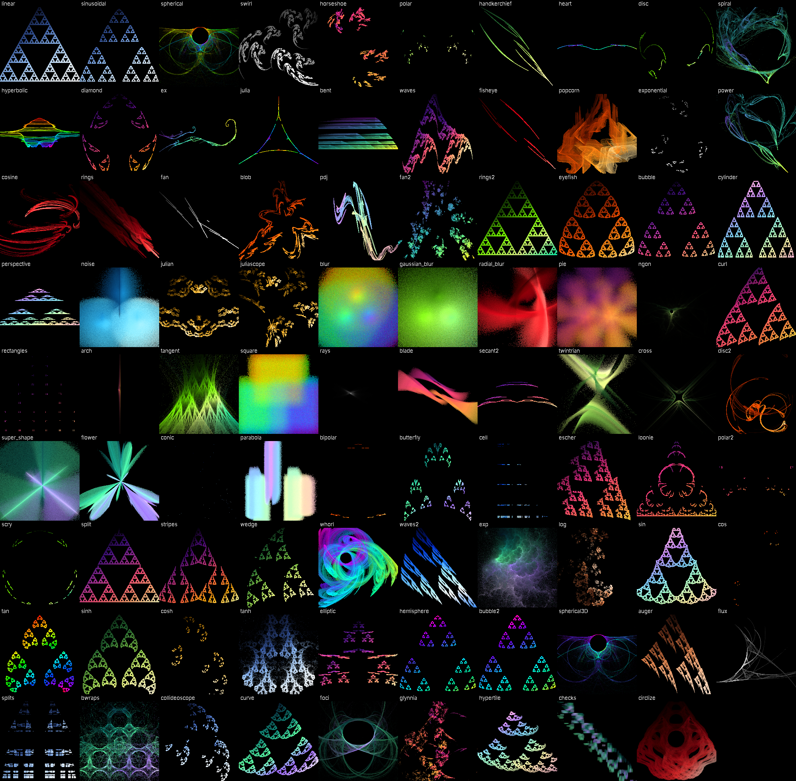

# FlameDroid

A fractal flame editor for Android, built around a Kotlin port of **89 variations from JWildfire**.
It opens and saves JWildfire / Apophysis `.flame` files, so you can move flames between your phone and desktop.



## Features

- **89 JWildfire variations**, ported line by line from JWildfire's source, with the same names and parameter names
- Live progressive preview; pinch, drag and twist to move the camera
- Transform editor: JWildfire-style triangle view (drag to move), rotate, scale, flip, pre and post affine, exact coefficients
- Final transform, weights, color, color speed (symmetry), opacity, xaos
- Per-variation amount and parameter sliders; tap any value to type an exact number; dice randomizes parameters
- 18 built-in gradients, random gradients, shift and reverse, background color
- Tone mapping: brightness, gamma, gamma threshold, vibrancy, contrast
- **New fractal** screen: pick from a gallery of random fractals in any style, or start from
  10 templates (Sierpinski, Fern, Dragon, Julia spiral, Galaxy, Kaleidoscope, Hyperbolic tiling, ...)
- Random generator styles: Classic, Symmetric, Spiral, Julians, Bubbles, Galaxy, Kaleidoscope, Tiles, Crystal; plus "mutate"
- Custom gradient editor: tap to add color points, tap a point for an HSV color picker
- Performance modes (Eco / Balanced / Fast) to trade preview speed against heat and battery
- Undo/redo, autosave, open/save `.flame` (multi-flame files supported), open `.flame` from file managers
- Render to PNG up to 3840 px at up to 1000 samples per pixel, saved to `Pictures/FlameDroid`

## Variations

`linear` `sinusoidal` `spherical` `swirl` `horseshoe` `polar` `handkerchief` `heart` `disc` `spiral` `hyperbolic`
`diamond` `ex` `julia` `bent` `waves` `fisheye` `popcorn` `exponential` `power` `cosine` `rings` `fan` `blob` `pdj`
`fan2` `rings2` `eyefish` `bubble` `cylinder` `perspective` `noise` `julian` `juliascope` `blur` `gaussian_blur`
`radial_blur` `pie` `ngon` `curl` `rectangles` `arch` `tangent` `square` `rays` `blade` `secant2` `twintrian` `cross`
`disc2` `super_shape` `flower` `conic` `parabola` `bipolar` `butterfly` `cell` `escher` `loonie` `polar2` `scry`
`split` `stripes` `wedge` `whorl` `waves2` `exp` `log` `sin` `cos` `tan` `sinh` `cosh` `tanh` `elliptic`
`hemisphere` `bubble2` `spherical3D` `auger` `flux` `splits` `bwraps` `collideoscope` `curve` `foci` `glynnia`
`hypertile` `checks` `circlize`

When you open a `.flame` file that uses a variation not in this list, the app tells you which ones it skipped.

## Building

**Android Studio:** open the `FlameDroid` folder, let Gradle sync, then Run on a device or emulator (Android 8.0+).

**Without Android Studio:** push the folder to a GitHub repository. The included workflow
(`.github/workflows/build.yml`) builds an installable APK on every push; download it from the
run's *Artifacts* section.

**Command line:** with the Android SDK installed, run `./gradlew :app:assembleRelease`.
The APK lands in `app/build/outputs/apk/release/`. It is signed with the debug key so it installs directly;
use your own signing key before publishing to a store.

## Project layout

```
engine/   Pure Kotlin flame engine (no Android dependencies)
  Core.kt         Point, random source, Variation base class
  Variations.kt   The 89 variations + registry
  Flame.kt        XForm (transform) and Flame models
  Renderer.kt     Multi-threaded chaos-game renderer, log-density tone mapping
  FlameXml.kt     .flame reader/writer (JWildfire, Apophysis, flam3 palettes)
  RandomFlame.kt  Random generators, mutation, auto-fit camera
  Palettes.kt     Gradients
app/      Jetpack Compose UI
```

## Adding more variations

Copy the `transform` (and `init`, if any) body from a JWildfire `*Func.java` file into a new class in
`Variations.kt`, declare its parameters with `param("name", default)`, and register it in `Variations`.
`pAffineTP` becomes `a`, `pVarTP` becomes `v`, `pAmount` becomes `amount`, `pContext` becomes `ctx`,
and `getPrecalcSqrt()` style calls become `a.precalcSqrt`.

## License

The variation code is derived from JWildfire (LGPL 2.1 or later); see [NOTICE.md](NOTICE.md).
